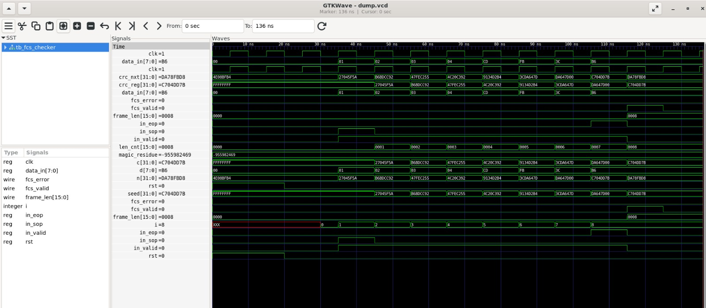
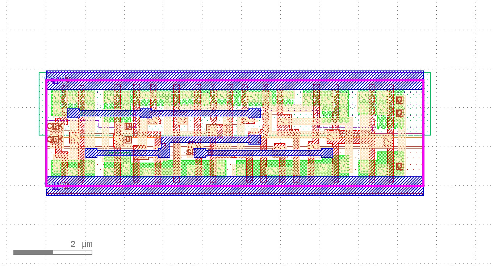
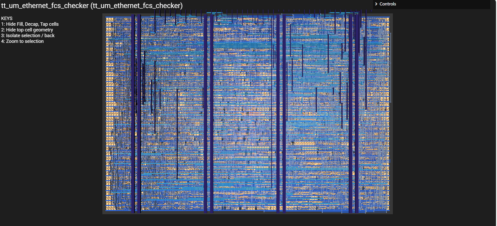
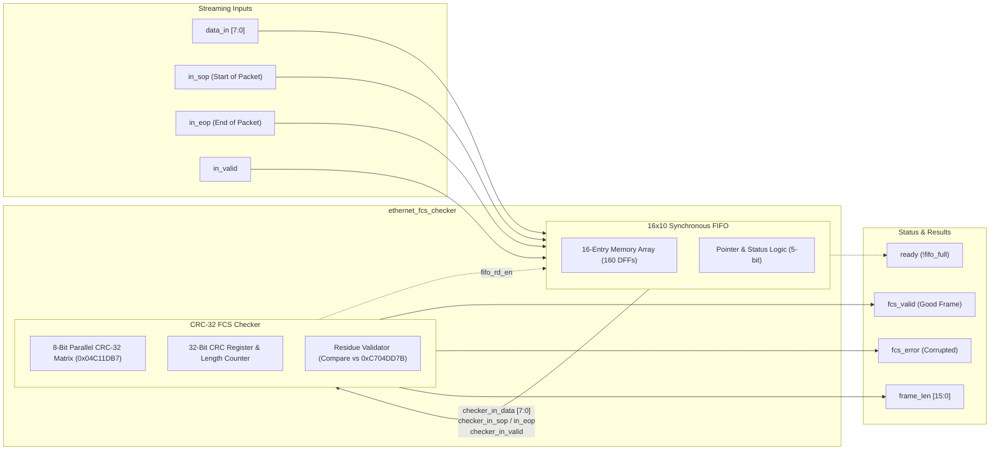

**Ethernet CRC Definition**
For a message M, the transmitted Ethernet frame is:
T = M · x^32 + FCS
where:
- M = Message/Payload
- FCS = Frame Check Sequence (CRC-32)
- T = Transmitted frame

**FCS Generation** 
- The CRC remainder is first computed as:

R = Remainder((M · x^32) / G)
where G is the Ethernet CRC-32 generator polynomial.

Ethernet then applies a final XOR with all 1s:

- FCS = R XOR 0xFFFFFFFF
What the Receiver Calculates
The receiver computes the CRC over the entire received frame:

- T = M · x^32 + FCS
Substituting the FCS expression:

- T = M · x^32 + R + 0xFFFFFFFF
Since R is the remainder of (M · x^32) divided by G:

- M · x^32 + R
is exactly divisible by G.

Therefore:

- Remainder(T / G)
=
Remainder(0xFFFFFFFF / G)
The message contribution cancels completely, leaving only a constant value.

**Ethernet CRC Residue**
For the IEEE 802.3 Ethernet CRC-32 algorithm:

Polynomial: 0x04C11DB7
Initial value: 0xFFFFFFFF
Input reflected: Yes
Output reflected: Yes
Final XOR: 0xFFFFFFFF
the CRC calculated over:

Payload + FCS
always yields:

0xDEBB20E3
This fixed value is known as the CRC Residue.

**Hardware Receiver Check**
A CRC checker can validate a received Ethernet frame by comparing the final CRC value against the known residue:
```verilog
localparam CRC_RESIDUE = 32'hDEBB20E3;

always_comb begin
    frame_valid = (crc_result == CRC_RESIDUE);
end
```
**Summary**
Transmit:
    FCS = CRC32(payload)

Receive:
    CRC32(payload + FCS) == 0xDEBB20E3

Valid Frame:
    CRC Result == 0xDEBB20E3
Any bit error in the payload or FCS will almost certainly cause the computed value to differ from 0xDEBB20E3, and the frame will be rejected.

**Results**

**waveform from output**


**Flip flop implementaion of crc32 checker**


**Tiny tapeout img of final desgin**

---
## Architecture



## OpenLane ASIC Implementation & Signoff Report

All physical design metrics and verification signoffs below are extracted directly from the latest flow run directory (`openlane/runs/RUN_2026-11-01_20-12-07/final/metrics.json`), which incorporates the **16-deep Synchronous FIFO** in front of the CRC-32 checker.

### 1. Design & Technology Overview
| Metric | Value | Baseline (No FIFO) | Change |
| :--- | :--- | :--- | :--- |
| **Top Module** | `ethernet_fcs_checker` | `ethernet_fcs_checker` | - |
| **Process Node / PDK** | SkyWater 130nm (`sky130A`) | SkyWater 130nm (`sky130A`) | - |
| **Standard Cell Library** | `sky130_fd_sc_hd` (High Density) | `sky130_fd_sc_hd` | - |
| **Target Clock Period** | `10.0 ns` (100 MHz) | `10.0 ns` (100 MHz) | - |
| **I/O Pin Count** | **34 pins** (added `ready` pin) | 33 pins | +1 pin |

### 2. Area & Floorplanning
| Parameter | Measurement | Baseline (No FIFO) |
| :--- | :--- | :--- |
| **Die Dimensions** | 204.645 µm × 215.365 µm | 140.455 µm × 151.175 µm |
| **Die Area** | **44,073.40 µm²** (0.044 mm²) | 21,233.30 µm² (0.021 mm²) |
| **Core Dimensions** | 198.72 µm × 204.00 µm | 129.26 µm × 127.84 µm |
| **Core Area** | **37,310.80 µm²** | 16,524.60 µm² |
| **Standard Cell Area** | **16,121.70 µm²** | 6,195.94 µm² |
| **Core Utilization** | **43.21%** | 37.50% |

### 3. Gate & Cell Count
| Cell Type | Count | Baseline (No FIFO) | Notes |
| :--- | :--- | :--- | :--- |
| **Total Standard Cells** | **1,867** | 819 | +1,048 cells |
| Sequential Cells (Registers / DFFs) | **236** | 66 | **+170 DFFs** (160 FIFO memory + 10 pointers) |
| Multi-Input Combinational Cells | **680** | 357 | FIFO read/write muxes & decoders |
| Inverters | **78** | 70 | |
| Timing Repair Buffers | **298** (193 hold, 0 setup) | 90 (28 hold, 0 setup) | Hold timing closure on register array |
| Clock Buffers & Inverters | **64** (44 buffers, 20 inverters) | 16 (12 buffers, 4 inverters) | Balanced CTS network |
| Physical Cells (Tap & Fillers) | 511 tap cells, 2,644 fill cells | 220 tap, 1,274 fill | Well-tie & density rule compliance |

### 4. Routing & Interconnect
| Metric | Result | Baseline (No FIFO) |
| :--- | :--- | :--- |
| **Total Wirelength** | **35,914 µm** (35.91 mm) | 14,358 µm (14.36 mm) |
| **Total Vias** | **8,710** (all singlecut) | 3,761 |
| **Detailed Routing DRC Convergence** | Iter 1: 332 → Iter 2: 73 → Iter 3: 32 → **Iter 4: 0** | Converged in 4 iterations |
| **Routing DRC Errors** | **0** | 0 |
| **Antenna Violations** | **0** | 0 |

### 5. Static Timing Analysis (STA)
| Corner | Conditions | Setup Slack (WNS) | Hold Slack (WNS) | Violations |
| :--- | :--- | :--- | :--- | :--- |
| **Nominal (`nom_tt`)** | 25°C, 1.80V | **+4.86 ns** (MET) | **+0.31 ns** (MET) | **0** |
| **Fast-Fast (`min_ff`)** | -40°C, 1.95V | **+6.21 ns** (MET) | **+0.11 ns** (MET) | **0** |
| **Slow-Slow (`max_ss`)** | 100°C, 1.60V | **-0.44 ns** | **+0.79 ns** (MET) | 2 setup violations |
| **Max Operating Frequency** | - | **~194.5 MHz** (Nominal / Typical) / **~95.8 MHz** (Worst PVT) | - | - |

### 6. Power Consumption (Nominal Corner: 25°C, 1.80V)
| Component | Power | Percentage | Baseline (No FIFO) |
| :--- | :--- | :--- | :--- |
| **Internal Power** | 6.366 mW | 55.1% | 1.132 mW |
| **Switching Power** | 5.192 mW | 44.9% | 0.796 mW |
| **Leakage Power** | 20.64 nW | < 0.01% | 8.05 nW |
| **Total Power** | **11.557 mW** | **100.0%** | **1.927 mW** |

### 7. Physical Verification & Signoff
| Verification Check | Status | Notes |
| :--- | :--- | :--- |
| **Magic DRC** | **CLEAN (0 errors)** | 0 DRC violations, 0 illegal overlaps |
| **LVS (Layout vs Schematic)** | **CLEAN (0 errors)** | 0 net, device, pin, or property discrepancies |
| **Antenna Check** | **CLEAN (0 violations)** | 0 violating nets/pins |
| **IR Drop Analysis** | **CLEAN** | Max IR drop: 2.97 mV, Avg: 0.498 mV |
| **Power Grid Violations** | **CLEAN (0)** | VGND: 0, VPWR: 0 |

### 8. Generated Final Deliverables (`openlane/runs/RUN_2026-11-01_20-12-07/final/`)
- **GDSII**: `final/gds/ethernet_fcs_checker.gds`
- **DEF**: `final/def/ethernet_fcs_checker.def`
- **LEF**: `final/lef/ethernet_fcs_checker.lef`
- **Gate-Level & Powered Netlists**: `final/nl/ethernet_fcs_checker.nl.v`, `final/pnl/ethernet_fcs_checker.pnl.v`
- **Timing & Parasitic Models**: `final/lib/`, `final/sdf/`, `final/spef/`, `final/sdc/`
- **SPICE Netlist**: `final/spice/ethernet_fcs_checker.spice`
